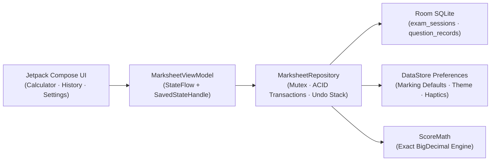

<div align="center">

# Marksheet

**A fast, exact, distraction-free exam score calculator for Android with per-question mark tracking, session history, and eye-friendly themes.**

[-3DDC84?style=flat-square&logo=android&logoColor=white)](https://developer.android.com)
[](https://kotlinlang.org)
[](https://developer.android.com/jetpack/compose)
[](#privacy--permissions)
[](LICENSE)

</div>

---

## Overview

**Marksheet** is a purpose-built Android utility for grading and tallying objective exams (OMR sheets, competitive mocks, practice tests). Instead of losing count on a generic calculator or juggling spreadsheets, tap one of three thumb-zone controls — **Add Mark**, **Negative**, or **Skip Question** — while Marksheet records the exact mark assigned to every question number, computes live statistics with zero floating-point drift, and stores your complete session history offline.

## Download & Install

Pre-built installable APKs are published automatically via GitHub Actions:

1. Open the [**Releases**](../../releases) page of this repository.
2. Download the latest `Marksheet-*.apk` file onto your Android device (Android 7.0 / API 24 or higher).
3. Tap the downloaded APK to install (enable *Install unknown apps* for your browser or file manager if prompted).

## Features

- **Three-Button Operational Keypad**: Ergonomic thumb-zone buttons for **Add Mark (`+1`)**, **Negative (`-0.25`)**, and **Skip Question (`0`)**, showing live configured values with tactile press feedback and optional haptics.
- **Exact `BigDecimal` Arithmetic**: Zero floating-point drift for fractional marking schemes (`0.25`, `0.33`, `0.66`, up to 4 decimal places) and clean formatting without trailing zeros or `-0`.
- **Per-Question Mark Recording**: Every question number (`Q1`–`QN`) stores its exact assigned action and mark delta in SQLite (Room) on every tap, surviving app restarts and process death.
- **Live Question Tape & Full Sheet Grid**:
  - Auto-scrolling horizontal tape showing recorded question chips (`Q14 +1`, `Q15 -0.25`, `Q16 SKIP`).
  - Expandable full `Q1–QN` **Question Sheet** grid with color-coded legend to jump to, reassign, or clear any specific question.
  - **Reversible Undo**: Reverts newly recorded marks, edits to earlier questions, and cleared entries accurately.
- **Session History & Audit View**:
  - Stores every completed and in-progress session with its marking scheme snapshot, total score, max score, score percentage, accuracy percentage, and Correct / Wrong / Skipped counts.
  - Inspect any saved session with `All` / `Correct` / `Wrong` / `Skipped` filters, open its full question sheet, rename or delete it, or reopen it in the calculator.
- **Configurable Marking Schemes & Exam Presets**:
  - Customize **Positive Mark**, **Negative Deduction** (supports `0` for no negative marking), and **Total Questions** (`1`–`1000`).
  - Built-in 1-tap presets: **Standard** (`+1 / -0.25 • 100 Qs`), **JEE / NEET** (`+4 / -1 • 90 Qs`), **NEET Full** (`+4 / -1 • 180 Qs`), **UPSC Prelims** (`+2 / -0.66 • 100 Qs`), **SSC / Banking** (`+2 / -0.5 • 100 Qs`), and **No Negative** (`+1 / 0 • 100 Qs`).
  - Safe mid-session handling: choose whether updated defaults recalculate the current active session or apply only to future sessions.
- **Eye-Friendly Light & Neutral Dark Themes**:
  - Instant 1-tap theme toggle in the top bar and Appearance controls in Settings.
  - **Warm Paper Light**: Soft alabaster off-white (`#F3F1EA` background, `#F8F6F0` surfaces) — zero harsh pure-white glare.
  - **Graphite Dark**: Strictly achromatic dark graphite (`#101010` / `#1B1B1B`) with zero blue tint, plus an optional **Pure AMOLED Black (`#000000`)** toggle.
- **Adaptive Responsive Layout**: Edge-to-edge UI supporting compact phones (`NavigationBar`) and tablets/landscape (`NavigationRail` + two-pane calculator layout).

---

## Color System & Typography

| Theme Mode | Background | Card Surface | Primary Ink | Accent Semantics |
| :--- | :--- | :--- | :--- | :--- |
| **Warm Paper Light** | `#F3F1EA` | `#F8F6F0` | `#1C1C1A` | Emerald `#1F7A4F` · Terracotta `#C24134` · Stone `#5D5952` |
| **Graphite Dark** | `#101010` | `#1B1B1B` | `#EAEAEA` | Emerald `#1E5C3C` · Terracotta `#7A2821` · Graphite `#242424` |
| **AMOLED Black** | `#000000` | `#121212` | `#EAEAEA` | Emerald `#1E5C3C` · Terracotta `#7A2821` · Charcoal `#1A1A1A` |

Typography pairs locally bundled **Plus Jakarta Sans** for clean UI readability with tabular **JetBrains Mono** (`tnum`) so scores and counters never shift horizontally as numbers update.

---

## Architecture

Marksheet follows unidirectional **MVVM + Repository** architecture backed by local Room SQLite and Jetpack DataStore:



### Package Structure

```text
app/src/main/java/com/example/
├── MarksheetApplication.kt        # Process-wide Room, DataStore & Repository singletons
├── MainActivity.kt                # Edge-to-edge host with flash-free persisted theme loading
├── domain/
│   ├── Models.kt                  # ExamSession, QuestionRecord, AppConfig, ExamPreset
│   └── ScoreMath.kt               # Pure BigDecimal score calculator, validator & formatter
├── data/
│   ├── MarksheetEntities.kt       # Room entities with composite PK (sessionId, questionNumber)
│   ├── MarksheetDao.kt            # Reactive Flow queries & transactional DAO methods
│   ├── MarksheetDatabase.kt       # Singleton Room database ("marksheet_db")
│   ├── SettingsDataStore.kt       # Jetpack DataStore persistence for config & theme
│   └── MarksheetRepository.kt     # Mutex-guarded, transactional operations & reversible undo
└── ui/
    ├── MarksheetViewModel.kt      # Reactive state flows, SavedStateHandle & self-healing guard
    ├── MarksheetApp.kt            # Adaptive NavigationBar / NavigationRail shell
    ├── components/
    │   └── MarksheetComponents.kt # ScoreboardCard, QuestionSheetBottomSheet, Edit & Name dialogs
    ├── screens/
    │   ├── CalculatorScreen.kt    # Hero scoreboard, live tape & 3-button operational keypad
    │   ├── HistoryScreen.kt       # Aggregate stats & saved session history list
    │   ├── SessionDetailScreen.kt # Filtered per-question audit, full sheet & reopen flow
    │   └── SettingsScreen.kt      # Theme/AMOLED controls, validated scheme inputs & presets
    └── theme/
        ├── Color.kt               # Warm Paper Light, Neutral Graphite Dark & AMOLED palettes
        ├── Type.kt                # Bundled Plus Jakarta Sans & tabular JetBrains Mono styles
        └── Theme.kt               # MarksheetTheme + CompositionLocal semantic tokens
```

---

## Tech Stack

| Layer | Technology |
| :--- | :--- |
| Language | Kotlin |
| UI Framework | Jetpack Compose + Material Design 3 |
| Local Database | Room (`2.7.0`) with KSP code generation |
| Preferences | Jetpack DataStore Preferences (`1.1.7`) |
| Concurrency | Kotlin Coroutines & Flow |
| Math Engine | `java.math.BigDecimal` |
| Minimum / Target SDK | API 24 (Android 7.0) / API 36 |
| Testing | JUnit 4 + Robolectric |

---

## Getting Started

### Prerequisites

- **JDK 17** or higher
- **Android Studio** (Meerkat / Ladybug or newer) or Android SDK Command-Line Tools with **Android SDK 36**
- **Gradle 9.3.1** (or open directly in Android Studio)

### Clone & Build

```bash
git clone https://github.com/DoctorLestrange/MarksheetAndroid.git
cd MarksheetAndroid

# Create a local debug keystore if not already present
if [ ! -f debug.keystore ]; then
  if [ -f debug.keystore.base64 ]; then
    base64 -d debug.keystore.base64 > debug.keystore
  else
    keytool -genkeypair -v \
      -keystore debug.keystore \
      -storepass android \
      -alias androiddebugkey \
      -keypass android \
      -keyalg RSA \
      -keysize 2048 \
      -validity 10000 \
      -dname "CN=Android Debug,O=Android,C=US"
  fi
fi

# Build debug APK
gradle :app:assembleDebug
```

### Run Tests & Lint

```bash
# Run unit tests (ScoreMath exact arithmetic, bounds, validation & gap handling)
gradle :app:testDebugUnitTest --tests "com.example.ScoreMathTest"

# Run full Android Lint analysis
gradle :app:lintDebug
```

### Automated GitHub Releases & Production Signing

Every push to `main`/`master` automatically publishes an installable APK to the `latest` GitHub Release, and pushing a version tag (e.g., `git tag v1.0.0 && git push origin v1.0.0`) publishes a versioned release.

By default, automated releases build a directly installable APK with zero setup required. To automatically publish **production-signed Release APKs & Google Play AABs**, add these three secrets under **Settings → Secrets and variables → Actions**:

| GitHub Secret | Description |
| :--- | :--- |
| `RELEASE_KEYSTORE_BASE64` | Base64-encoded `.jks` upload keystore (`base64 -w 0 my-upload-key.jks`) |
| `RELEASE_STORE_PASSWORD` | Keystore password |
| `RELEASE_KEY_PASSWORD` | Key password for alias `upload` |

For local release builds:

```bash
export KEYSTORE_PATH=/path/to/your-upload-key.jks
export STORE_PASSWORD=your_store_password
export KEY_PASSWORD=your_key_password

# Build release Android App Bundle (.aab) for Google Play
gradle :app:bundleRelease

# Or build release APK
gradle :app:assembleRelease
```

---

## Privacy & Permissions

- **No Sensitive Permissions**: Marksheet works **100% offline** with no internet, storage, camera, location, or contacts permissions. It declares only the standard install-time `VIBRATE` permission to power optional tactile haptic feedback.
- **Local Storage Only**: All exam sessions, per-question mark records, and settings stay strictly on your device in Room SQLite and DataStore.
- **Android Auto Backup**: Explicit `backup_rules.xml` and `data_extraction_rules.xml` rules include the database and preferences for seamless Android device upgrades.

---

## Contributing

Contributions, bug reports, and feature suggestions are welcome! Please read [CONTRIBUTING.md](CONTRIBUTING.md) and our [Code of Conduct](CODE_OF_CONDUCT.md) before opening a pull request.

## License

This project is licensed under the **MIT License** — see the [LICENSE](LICENSE) file for details.
